# Catalogue

Every layout and every visual shipped with the skill, generated from the indexes (`skills/make-clean-pptx/assets/*.csv`). Browse it with filters on the [gallery page](https://maximerumpler.github.io/Make_Clean_PPTX/).

## Layouts (54)

### Cover

| | | |
|:---:|:---:|:---:|
| 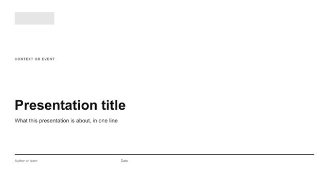 **L-01** Cover, title left Default opening for reports, reviews and proposals. | 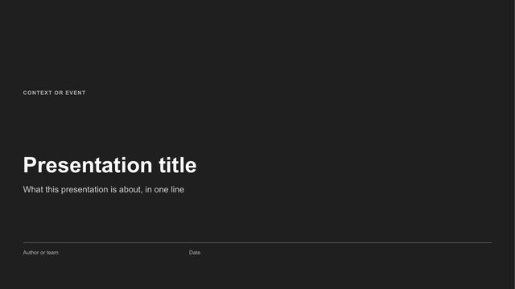 **L-02** Cover, dark Executive or keynote opening that needs presence. | 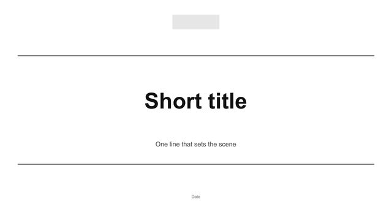 **L-03** Cover, typographic Short punchy title (two to five words), editorial or manifesto tone. |
|  **L-04** Cover, split image Opening that benefits from a strong photo (place, product, people). | 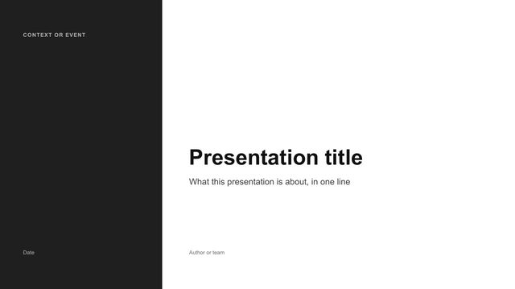 **L-05** Cover, side band Formal opening with a strong structure; works well for board and committee decks. |  |

### Agenda

| | | |
|:---:|:---:|:---:|
| 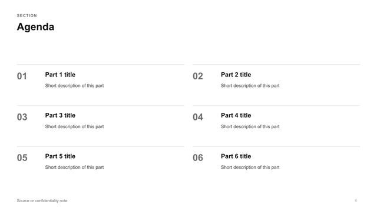 **L-06** Agenda, numbered Table of contents for decks with three to six parts. | 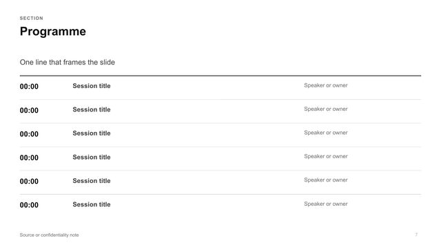 **L-07** Agenda, timed sessions Workshop, seminar or meeting programme with times and speakers. | 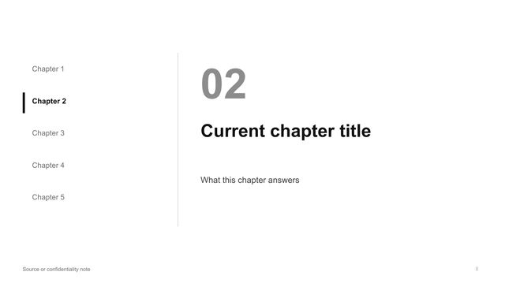 **L-08** Agenda, active chapter Reminder of where we are, between parts of a long deck. |

### Divider

| | | |
|:---:|:---:|:---:|
|  **L-09** Chapter divider, dark Start of a new part in decks of fifteen slides or more. | 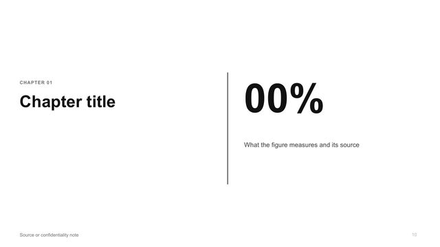 **L-10** Divider with key figure Opening a chapter with the single number that motivates it. | 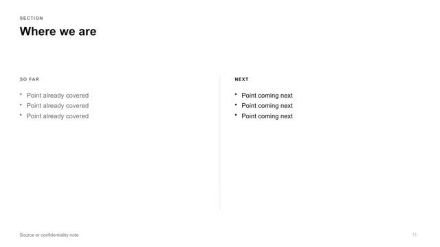 **L-11** Transition, seen and next Bridge between the diagnosis and the proposal, or between two parts. |

### Statement

| | | |
|:---:|:---:|:---:|
| 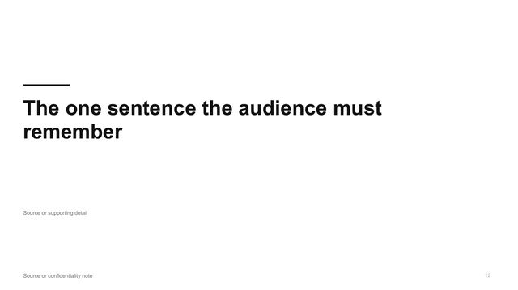 **L-12** Key message The single takeaway the audience must remember; a turning point in the story. | 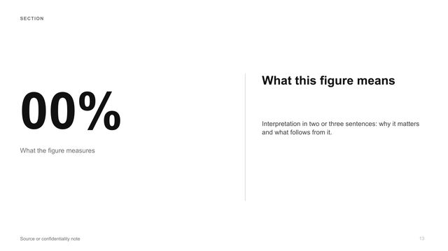 **L-13** Figure and interpretation One fact carries the argument: show the number, then say what it means. | 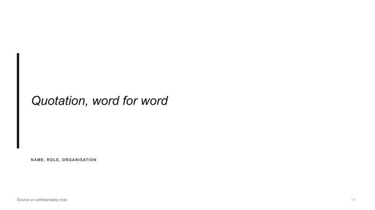 **L-14** Big quote A customer, expert or leader said it better; use real quotes only. |
| 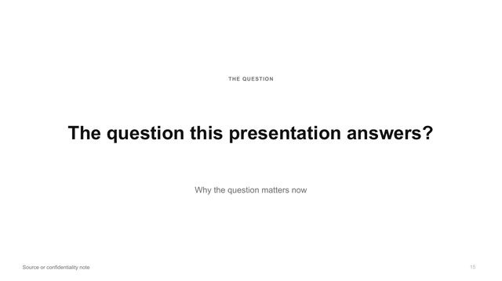 **L-15** Strategic question Opening a debate or a decision: state the question before the answers. | 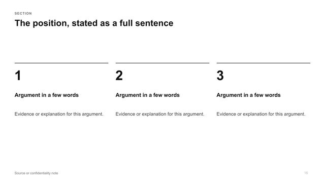 **L-16** Position and three arguments Take a stand and back it with three reasons. | 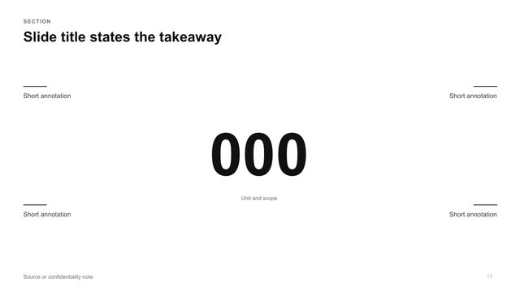 **L-17** Central figure with annotations A number that needs context from several angles (cause, trend, comparison, consequence). |

### Text

| | | |
|:---:|:---:|:---:|
| 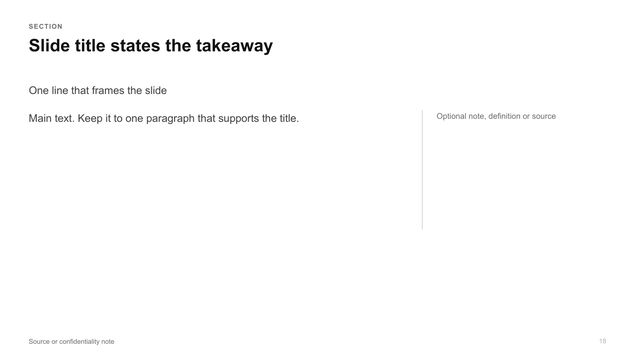 **L-18** Title and text A paragraph of explanation that does not split into parallel points. | 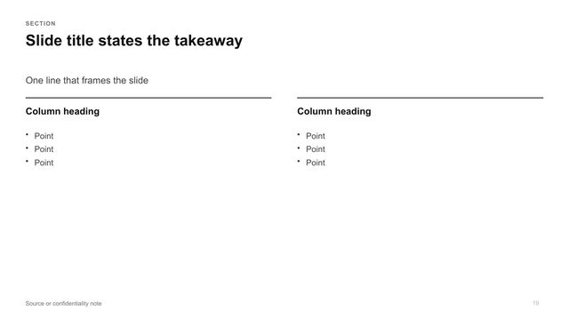 **L-19** Two columns Two parallel ideas: problem and solution, today and tomorrow, two audiences. | 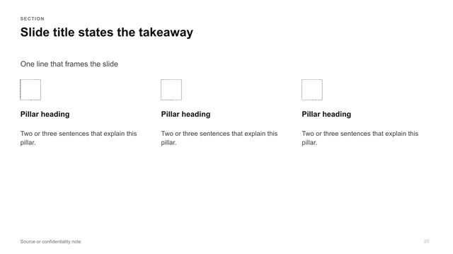 **L-20** Three columns with icons Three pillars, benefits, principles or offers of equal weight. |
| 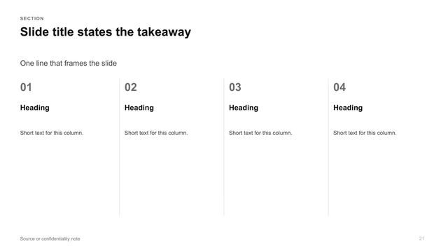 **L-21** Four columns Four steps, levers or components that read left to right. | 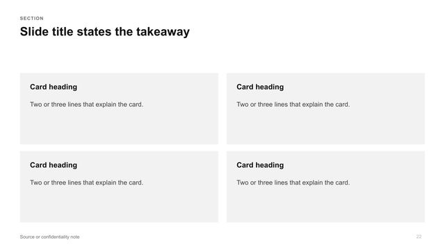 **L-22** Four cards Four items of equal weight that need a few lines each (findings, recommendations). | 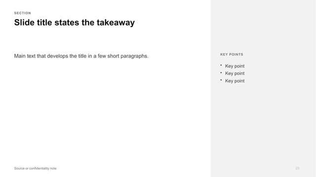 **L-23** Main content and sidebar Explanation plus the facts, definitions or figures the reader should keep. |
| 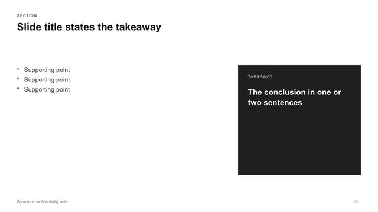 **L-24** Text with takeaway box The reasoning matters but the conclusion must stand out. | 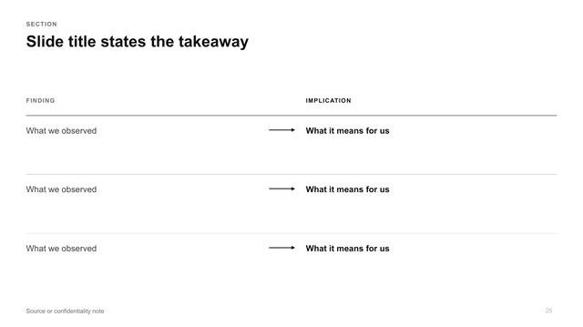 **L-25** Findings and implications Turning a diagnosis into consequences: what we saw, what it means. | 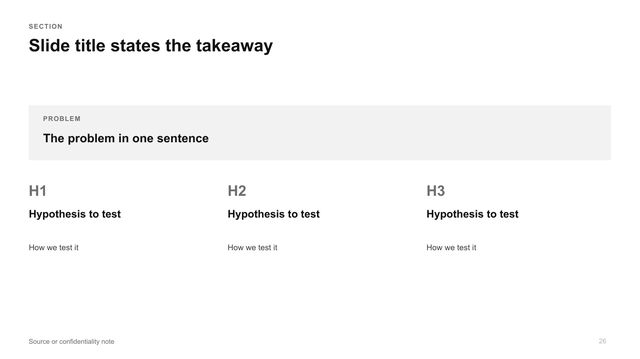 **L-26** Problem and hypotheses Framing an analysis: the problem and the hypotheses to test. |

### Media

| | | |
|:---:|:---:|:---:|
|  **L-27** Text and image A message that a photo makes concrete: a site, a product, a team at work. |  **L-28** Full image with caption box Emotional or contextual moment carried by one strong picture. | 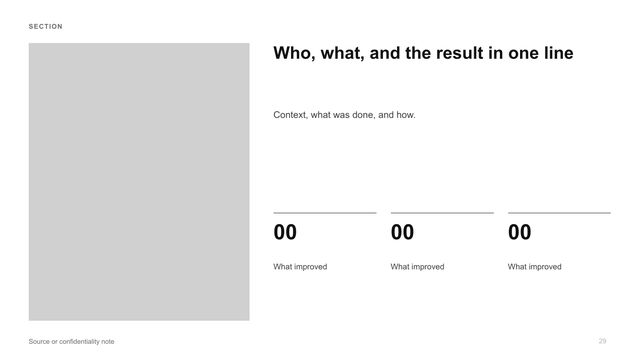 **L-29** Case study Customer story, project reference or pilot with measurable results. |

### Team

| | | |
|:---:|:---:|:---:|
| 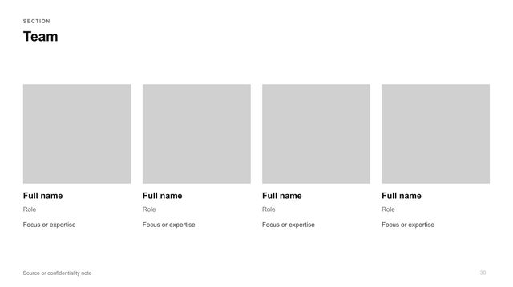 **L-30** Team of four Introducing the team, the speakers or the key contacts. |  |  |

### Frame

| | | |
|:---:|:---:|:---:|
| 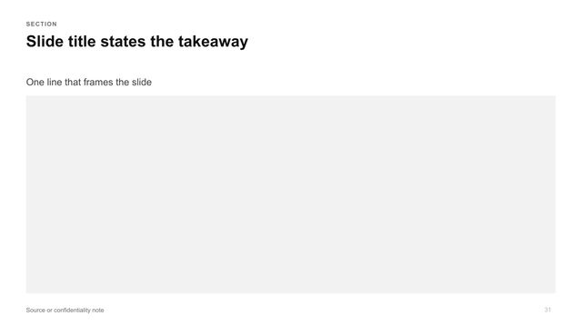 **L-31** Full visual The visual is the message and needs all the room (roadmap, process, big chart). | 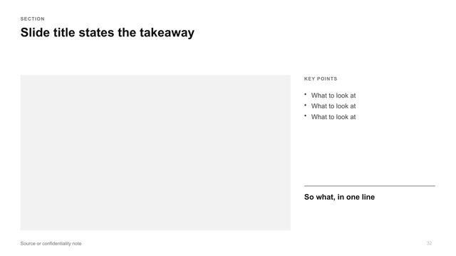 **L-32** Visual and key points A chart that needs reading help: what to look at and what it means. | 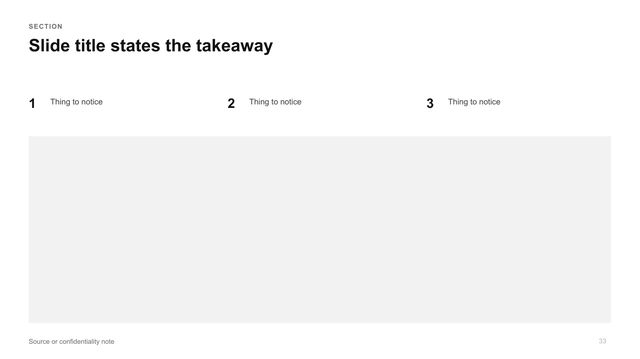 **L-33** Visual with three callouts A visual with three things to notice, read before looking at it. |
| 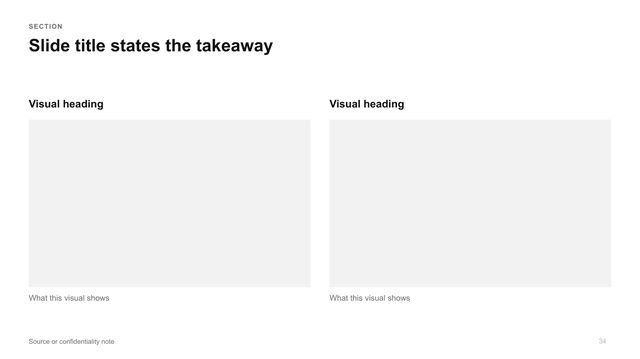 **L-34** Two visuals Comparing two charts or diagrams: before and after, two segments, two periods. | 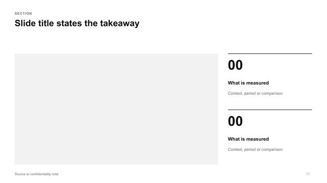 **L-35** Visual and two figures A trend or breakdown with the two numbers that summarise it. | 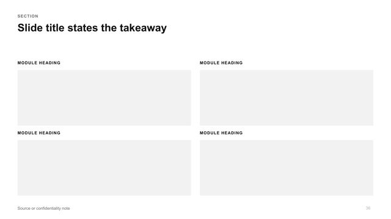 **L-36** Dashboard, four modules Monitoring view: four indicators or charts read together. |

### KPI

| | | |
|:---:|:---:|:---:|
| 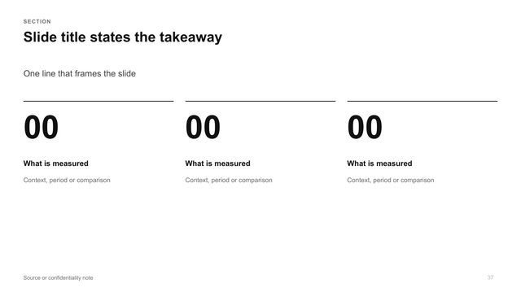 **L-37** Three figures Three numbers that tell the story of a period, a project or an offer. | 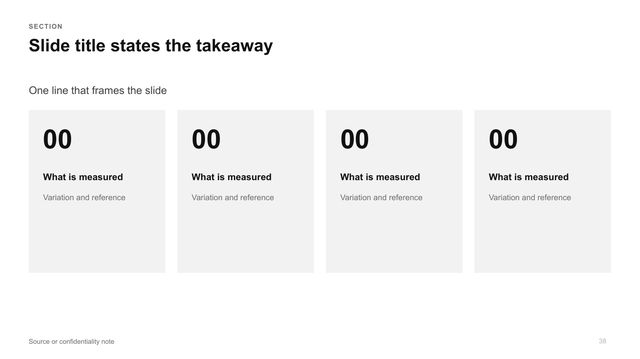 **L-38** Four figures on cards Four indicators of a scorecard; each needs a short comparison. | 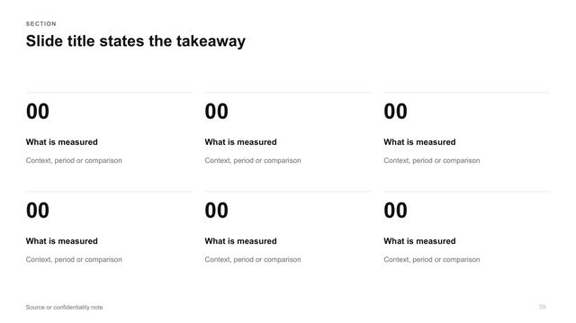 **L-39** Six figures Overview of up to six indicators without charts. |
| 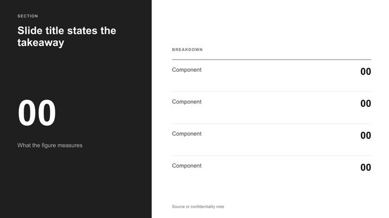 **L-40** Hero figure and breakdown A total and what it is made of; a headline result and its drivers. |  |  |

### Table

| | | |
|:---:|:---:|:---:|
| 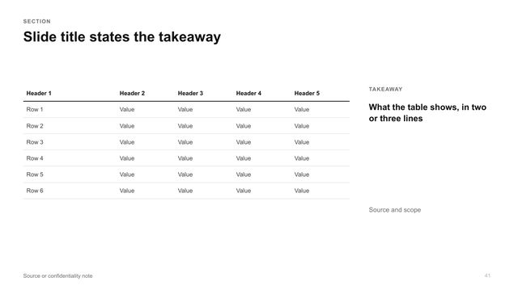 **L-41** Table and takeaway Detailed comparison or figures that must be read row by row, with the conclusion beside. | 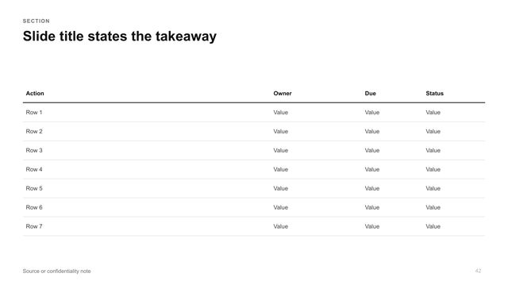 **L-42** Action plan Who does what by when; follow-up of decisions. |  |

### Decision

| | | |
|:---:|:---:|:---:|
| 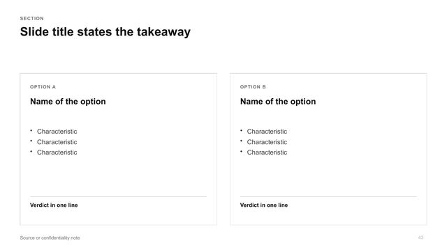 **L-43** Two options Choice between two scenarios presented neutrally. | 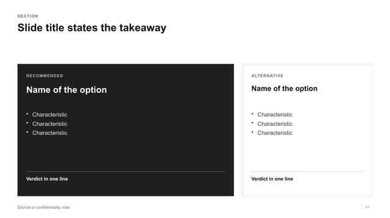 **L-44** Recommended option You recommend one option and show the alternative you discarded. | 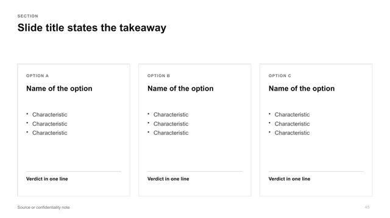 **L-45** Three options Choice between three scenarios (do nothing, partial, full). |
| 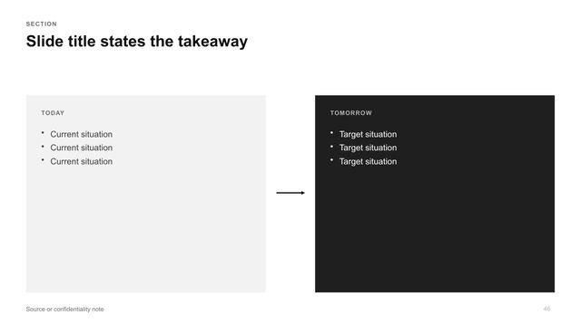 **L-46** Before and after Transformation, as-is versus to-be, the change you propose. |  |  |

### Closing

| | | |
|:---:|:---:|:---:|
| 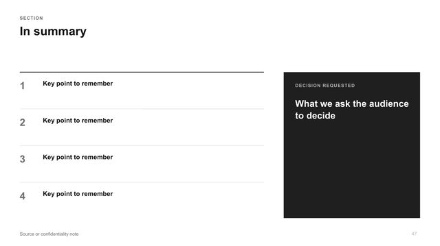 **L-47** Summary and decision End of a decision deck: what to remember and what we ask for. | 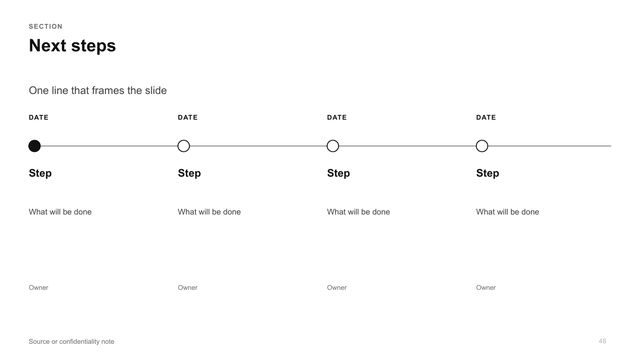 **L-48** Next steps Closing with what happens next and who does it. | 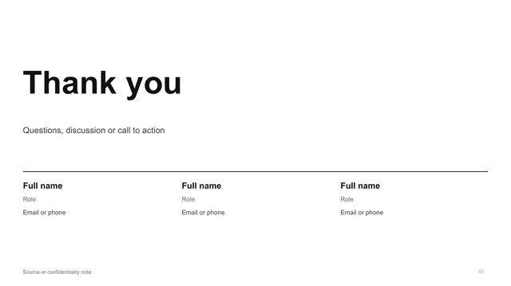 **L-49** Thank you and contacts Last slide: thanks, questions, who to contact. |

### Editorial

| | | |
|:---:|:---:|:---:|
| 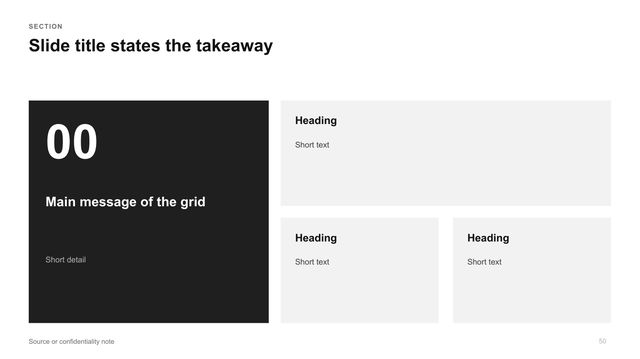 **L-50** Bento grid A rich overview (offer, results, programme) where one element dominates. | 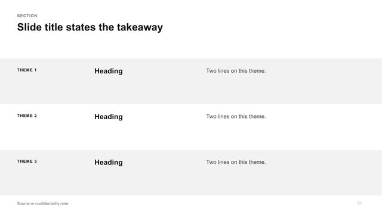 **L-51** Horizontal bands Three themes or periods read top to bottom (past, present, future). | 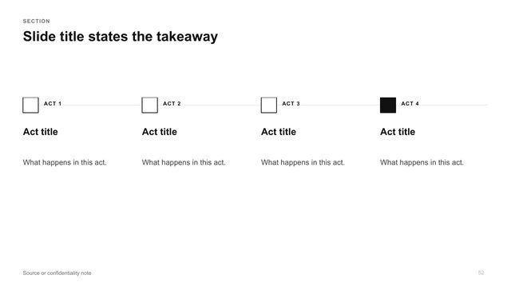 **L-52** Story in four acts Narrative arc: situation, complication, resolution, outcome. |
| 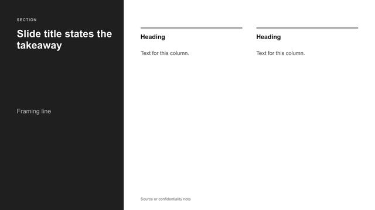 **L-53** Side panel Dense content that needs a strong anchor; executive summaries. |  |  |

### Process

| | | |
|:---:|:---:|:---:|
| 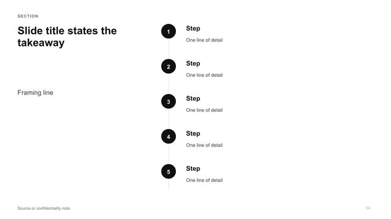 **L-54** Vertical sequence A method, procedure or chronology of up to five steps with a line of detail each. |  |  |

## Visuals (81)

### Compare

| | | |
|:---:|:---:|:---:|
|  **V-CMP-01** Ranked bars Rank items on one measure (regions, products, causes). Best with 3 to 12 items. |  **V-CMP-02** Two periods Same items measured at two moments (year on year, before and after). |  **V-CMP-03** Progress to target Achievement against objectives for several teams, projects or indicators. |
|  **V-CMP-04** Sensitivity tornado Which assumptions move the result most: sensitivity analysis, risk drivers. |  **V-CMP-05** Slope chart Change in ranking or value between two dates for 3 to 7 items. |  **V-CMP-06** Scored comparison Compare 2 to 4 options on 3 to 6 qualitative criteria; supplier or scenario choice. |

### Evolve

| | | |
|:---:|:---:|:---:|
|  **V-EVO-01** Line with annotation A trend and the event that explains it (launch, crisis, policy change). |  **V-EVO-02** Stacked area Growth of a total and the changing weight of 2 to 4 components. |  **V-EVO-03** Columns and line Volume and ratio together: revenue and margin, users and conversion. |
|  **V-EVO-04** Plan versus actual Project progress, budget burn, cumulative sales against plan (S-curve). |  **V-EVO-05** Trend table Several indicators whose direction matters more than their detail. |  **V-EVO-06** Small multiples The same trend for several segments; avoids a tangle of lines on one chart. |

### Compose

| | | |
|:---:|:---:|:---:|
|  **V-COM-01** Waterfall bridge Explain a variation: budget to actual, last year to this year, price walk. |  **V-COM-02** Mix bars Compare the mix (shares) across groups: channels by region, cost structure by unit. |  **V-COM-03** Donut with total Share of a total with 2 to 5 parts, when one part dominates. |
|  **V-COM-04** Simple pie One clear majority versus the rest ("two thirds of customers..."). |  **V-COM-05** Funnel Conversion through successive stages: marketing, sales, recruitment, validation. |  **V-COM-06** Stacked columns Total and its composition for 3 to 8 periods (revenue by product per year). |

### Relate

| | | |
|:---:|:---:|:---:|
|  **V-REL-01** Scatter plot Is X linked to Y? Price and volume, effort and result, size and growth. |  **V-REL-02** Bubble portfolio Portfolio of products, projects or markets: attractiveness, position and size. |  **V-REL-03** Histogram How values are spread: delays, order sizes, ages, scores. |
|  **V-REL-04** Heatmap grid Intensity across two dimensions: activity by day and hour, sales by product and region, cohort retention. |  **V-REL-05** Pareto Find the few causes that explain most of the effect (80/20). |  |

### KPI

| | | |
|:---:|:---:|:---:|
|  **V-KPI-01** KPI cards with change A compact scorecard inside a slide that also carries text or a chart. |  **V-KPI-02** Progress rings Completion or achievement rates (percent of target, percent done). |  **V-KPI-03** Figure with trend The headline figure of a slide, with just enough history to show the direction. |
|  **V-KPI-04** Status list Project or programme status report (on track, at risk, late). |  **V-KPI-05** Gauge One rate against its maximum: capacity used, satisfaction score, budget consumed. |  |

### Matrix

| | | |
|:---:|:---:|:---:|
|  **V-MAT-01** Two-by-two matrix Position up to eight items on two criteria (value and feasibility, urgency and importance). |  **V-MAT-02** SWOT Summarise a diagnosis before choosing a strategy. |  **V-MAT-03** Impact and effort Choose which initiatives to launch first. |
|  **V-MAT-04** Risk matrix Risk register summary for a project, a programme or a decision. |  **V-MAT-05** Nine-box grid Segment people, products or markets on two three-level scales (performance and potential). |  **V-MAT-06** Positioning map Competitive positioning, perception maps, where we stand against alternatives. |

### Process

| | | |
|:---:|:---:|:---:|
|  **V-PRO-01** Chevron process A linear method or phases of a project, 3 to 5 steps. |  **V-PRO-02** Cycle A recurring loop: continuous improvement, planning cycle, customer lifecycle. |  **V-PRO-03** Swimlane flow Who does what in a process with hand-offs: approval workflows, order to cash. |
|  **V-PRO-04** Stage-gate Development or investment process with go / no-go decisions. |  **V-PRO-05** Customer journey Map an experience end to end: customer, employee or user journey. |  **V-PRO-06** Double diamond Design or innovation method: discover, define, develop, deliver. |
|  **V-PRO-07** Staircase Maturity levels, capability growth, a progression plan. |  |  |

### Time

| | | |
|:---:|:---:|:---:|
|  **V-TIM-01** Milestone timeline Key dates of a project, a history, a launch plan. |  **V-TIM-02** Roadmap by lanes Multi-stream roadmap over quarters or years. |  **V-TIM-03** Gantt chart Detailed schedule with tasks and durations. |
|  **V-TIM-04** Three horizons Balance short-term performance with mid- and long-term growth (portfolio, innovation). |  **V-TIM-05** Now, next, later Product or programme roadmap without committed dates. |  **V-TIM-06** Serpentine timeline A long sequence that a single line would cram: a programme of six to eight phases, a history, an onboarding path. |

### Structure

| | | |
|:---:|:---:|:---:|
|  **V-STR-01** Organisation chart Organisation, governance or team structure on three levels. |  **V-STR-02** Logic tree Break a problem or objective into its drivers (issue tree, KPI tree, decision tree). |  **V-STR-03** Pyramid Hierarchy of needs, priorities or foundations (vision to operations). |
|  **V-STR-04** Layered architecture System, data or operating model architecture; stack of capabilities. |  **V-STR-05** Hub and spoke Ecosystem around a core: partners, stakeholders, services around a platform. |  **V-STR-06** Venn diagram Where three domains meet: the sweet spot, a skills profile, a value proposition. |
|  **V-STR-07** Fishbone Root cause analysis of a quality, delay or performance problem. |  **V-STR-08** Concentric circles Scope or influence by distance: core business, adjacent, ecosystem; TAM SAM SOM. |  **V-STR-09** Half-ring layers Layers that build outwards from a core: capabilities around a product, circles of stakeholders, foundations to reach. |

### Frameworks

| | | |
|:---:|:---:|:---:|
|  **V-FRM-01** Business model canvas Describe or compare business models. |  **V-FRM-02** Five forces Assess the attractiveness of an industry or segment. |  **V-FRM-03** PESTEL Scan the external environment before a strategy or a market entry. |
|  **V-FRM-04** RACI matrix Clarify who is responsible, accountable, consulted and informed. |  **V-FRM-05** OKR tree Present objectives and key results, or any goal with measurable outcomes. |  **V-FRM-06** Value chain Where value is created in a company; locate costs, strengths or improvements. |

### Signature

| | | |
|:---:|:---:|:---:|
|  **V-SIG-01** Meshing gears Signature metaphor, only on request or when the idea is that parts drive each other: a mechanism, teams or levers working together. |  **V-SIG-02** Light bulb Signature metaphor, only on request or when the slide introduces one idea and its three facets: an insight, an innovation, a proposal. |  **V-SIG-03** Puzzle Signature metaphor, only on request or when four parts must fit together to make the whole: a solution, an offer, a team. |
|  **V-SIG-04** Winding road Signature metaphor, only on request or when the story is a journey: a transformation path, a programme told as a road ahead. |  **V-SIG-05** Mountain and summit flag Signature metaphor, only on request or when the message is an ambition reached in stages: a target state, a long climb, a vision. |  **V-SIG-06** Target Signature metaphor, only on request or when the message is focus on one aim: the objective, the core target and what surrounds it. |

### Expressive

| | | |
|:---:|:---:|:---:|
|  **V-ORB-01-3** Orbit, 3 satellites Expressive composition, only on request: one centre and exactly 3 things that revolve around it (an ecosystem, stakeholders around a product, capabilities around a core). Fallback: V-STR-05 hub and spoke for dense text, a list layout above 8 items. |  **V-ORB-01-4** Orbit, 4 satellites Expressive composition, only on request: one centre and exactly 4 things that revolve around it (an ecosystem, stakeholders around a product, capabilities around a core). Fallback: V-STR-05 hub and spoke for dense text, a list layout above 8 items. |  **V-ORB-01-5** Orbit, 5 satellites Expressive composition, only on request: one centre and exactly 5 things that revolve around it (an ecosystem, stakeholders around a product, capabilities around a core). Fallback: V-STR-05 hub and spoke for dense text, a list layout above 8 items. |
|  **V-ORB-01-6** Orbit, 6 satellites Expressive composition, only on request: one centre and exactly 6 things that revolve around it (an ecosystem, stakeholders around a product, capabilities around a core). Fallback: V-STR-05 hub and spoke for dense text, a list layout above 8 items. |  **V-ORB-01-7** Orbit, 7 satellites Expressive composition, only on request: one centre and exactly 7 things that revolve around it (an ecosystem, stakeholders around a product, capabilities around a core). Fallback: V-STR-05 hub and spoke for dense text, a list layout above 8 items. |  **V-ORB-01-8** Orbit, 8 satellites Expressive composition, only on request: one centre and exactly 8 things that revolve around it (an ecosystem, stakeholders around a product, capabilities around a core). Fallback: V-STR-05 hub and spoke for dense text, a list layout above 8 items. |
|  **V-ORB-02-2x4** Two orbits, 2 + 4 satellites Expressive composition, only on request: a centre with a close circle of 2 and a wider circle of 4 (core and extended team, direct and indirect stakeholders). Fallback: V-STR-05 hub and spoke for dense text, a list layout above 8 items. |  **V-ORB-02-3x5** Two orbits, 3 + 5 satellites Expressive composition, only on request: a centre with a close circle of 3 and a wider circle of 5 (core and extended team, direct and indirect stakeholders). Fallback: V-STR-05 hub and spoke for dense text, a list layout above 8 items. |  **V-ORB-02-3x6** Two orbits, 3 + 6 satellites Expressive composition, only on request: a centre with a close circle of 3 and a wider circle of 6 (core and extended team, direct and indirect stakeholders). Fallback: V-STR-05 hub and spoke for dense text, a list layout above 8 items. |
|  **V-ORB-02-4x6** Two orbits, 4 + 6 satellites Expressive composition, only on request: a centre with a close circle of 4 and a wider circle of 6 (core and extended team, direct and indirect stakeholders). Fallback: V-STR-05 hub and spoke for dense text, a list layout above 8 items. |  **V-ORB-03-3** Half orbit, 3 satellites Expressive composition for a half frame next to text, only on request: one centre and exactly 3 things around it. Fallback: V-STR-05 hub and spoke for dense text, a list layout above 8 items. |  **V-ORB-03-4** Half orbit, 4 satellites Expressive composition for a half frame next to text, only on request: one centre and exactly 4 things around it. Fallback: V-STR-05 hub and spoke for dense text, a list layout above 8 items. |
|  **V-ORB-03-5** Half orbit, 5 satellites Expressive composition for a half frame next to text, only on request: one centre and exactly 5 things around it. Fallback: V-STR-05 hub and spoke for dense text, a list layout above 8 items. |  |  |
