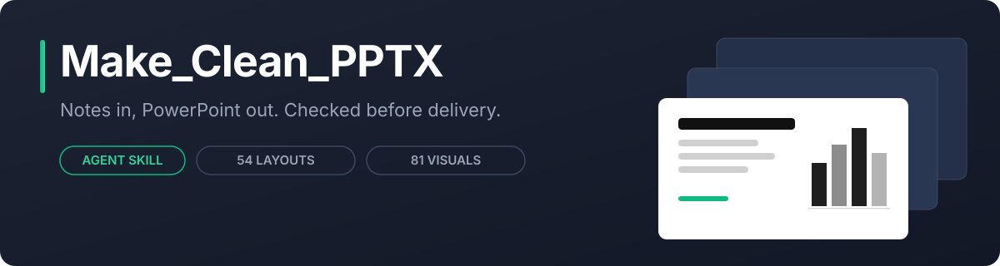
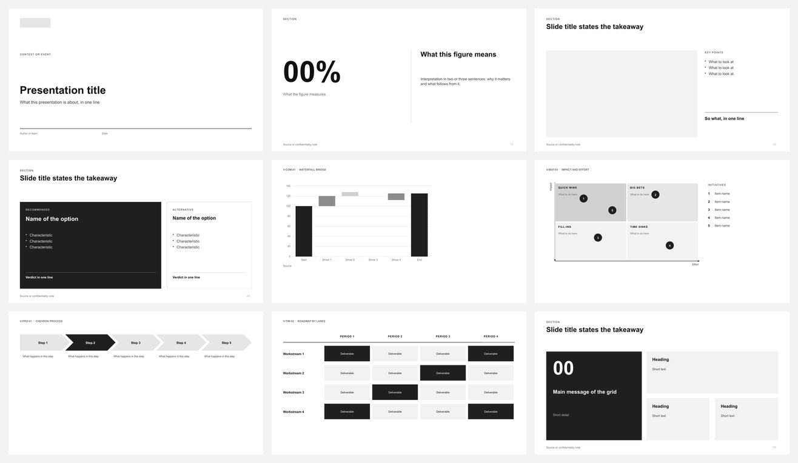

<div align="center">

[](https://maximerumpler.github.io/Make_Clean_PPTX/)

*Give your AI assistant your notes. Get back a clean, professional PowerPoint.*

[](https://github.com/MaximeRumpler/Make_Clean_PPTX/actions/workflows/ci.yml)
[](LICENSE)
[](https://maximerumpler.github.io/Make_Clean_PPTX/)
[](#install)

</div>

* * *

<div align="center">

[](https://maximerumpler.github.io/Make_Clean_PPTX/)

</div>

## What it does

Make Clean PPTX is a *skill*, a set of instructions and tools that teaches an AI assistant such as Claude or Codex to make presentations.

You give it your notes, a report or a few figures, in English or French. It writes one message per slide, takes a matching slide design and chart from its library, and checks the file before handing it over. It never makes up numbers.

The slides are black, grey and white. Apply your company's PowerPoint theme and they switch to your colours and fonts. They open in LibreOffice too.

* * *

## Install

| **Claude Code** | **Claude.ai and Claude desktop** | **Other AI assistants** |
|:---|:---|:---|
| `/plugin marketplace add MaximeRumpler/Make_Clean_PPTX`<br>then `/plugin install make-clean-pptx@make-clean-pptx` | Download [`make-clean-pptx.zip`](https://github.com/MaximeRumpler/Make_Clean_PPTX/releases/latest), then *Settings → Capabilities → Skills → Upload skill* | `npx skills add MaximeRumpler/Make_Clean_PPTX` |

Works the same on Windows, macOS and Linux. The skill needs Python, which most assistants already have. If something is missing, it tells you what to install.

**Update**: Claude Code, `/plugin marketplace update MaximeRumpler/Make_Clean_PPTX`; Claude.ai, upload the new zip; other assistants, run the `npx skills add` line again.

## Use

Just ask, in your own words:

```text
Make a 10-slide deck from this report for the board.
Fais-moi une présentation de 8 slides à partir de ces notes.
Review my-deck.pptx and make it look professional.
```

* * *

## What's inside

| **54 slide designs** | **60 charts and diagrams** | **1,900 icons** |
|:---:|:---:|:---:|
| covers, key messages, figures, options, next steps | bars, waterfalls, matrices, timelines, org charts | bundled, plus free online icons and photos |

Browse them in the [gallery](https://maximerumpler.github.io/Make_Clean_PPTX/). How it works and how to add your own designs: [docs/how-it-works.md](docs/how-it-works.md).

* * *

## Then add your colours

*From your content, first Make_Clean, then add your colours.* The companion skill [**Make_Colors_PPTX**](https://github.com/MaximeRumpler/Make_Colors_PPTX) (in preparation) turns a brand guide, a website or an example file into a PowerPoint theme and applies it to your clean deck.

* * *

## License

[EUPL-1.2](LICENSE), the open source licence of the European Union: free to use; if you share an improved version, share it under the same licence. **The presentations you make are yours**, with no obligation ([NOTICE](NOTICE)). Contributions are welcome: [CONTRIBUTING.md](CONTRIBUTING.md).

<div align="center">

Built by [**Maxime Rumpler**](https://github.com/MaximeRumpler) · [](https://github.com/KairosTech-fr) · [kairostech.fr](https://kairostech.fr)

</div>
