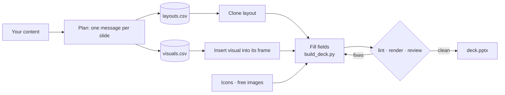

# How it works

How the skill builds a deck, what the agent writes, and how to change the libraries. For what it does, see the [README](../README.md).

## The flow

The agent writes one message per slide and picks a layout for each. When a layout has a frame, a chart or diagram goes into it. Every field has a character limit, and the deck is checked before delivery.



Nothing is drawn from scratch: the slides already exist and are cloned, so spacing, type and alignment stay exactly as designed. The libraries contain placeholders only, never sample content, and the skill never invents figures or quotes to fill a slot.

## Manual install and requirements

- **Claude Code without the plugin:** `git clone` this repository, then `./install.sh` (copies the skill to `~/.claude/skills/`; `--project` for `./.claude/skills/`).
- **Any other assistant:** `npx skills add MaximeRumpler/Make_Clean_PPTX`, or copy `skills/make-clean-pptx/` where it loads skills, or point it at [`AGENTS.md`](../AGENTS.md).
- **Windows:** the plugin, the zip and `npx skills add` work as is; `install.sh` needs Git Bash or WSL, or copy the `skills/make-clean-pptx/` folder by hand.
- **Updating:** the same command or upload again. `install.sh` replaces only a previous copy of this skill, never another folder.
- **Python 3.9+** with `pip install -r skills/make-clean-pptx/requirements.txt`. Optional, for the visual check: LibreOffice and poppler (`apt install libreoffice-impress poppler-utils`).
- The libraries, icons and indexes are bundled: building a deck works offline. Online sources (more icons, free photos) are used when available.

## Inside the libraries

| **Layouts** (54) | **Visuals** (68) |
|:---|:---|
| Cover 5 · Agenda 3 · Divider 3 · Statement 6 · Text 9 · Media 3 · Team 1 · Frame 6 · KPI 4 · Table 2 · Decision 4 · Closing 3 · Editorial 4 · Process 1 | Compare 6 · Evolve 6 · Compose 6 · Relate 5 · KPI 5 · Matrix 6 · Process 7 · Time 6 · Structure 9 · Frameworks 6 · Signature 6 (opt-in) |
| Chosen by what the message *is*: one figure, a stance and three reasons, a choice between options, a chart that needs commentary. Frames receive visuals. | Chosen by what the data *does*: compare, evolve, break down, relate, prioritise, plan, structure. Every quantitative visual is a native, editable chart. |

Each row of the index (`skills/make-clean-pptx/assets/*.csv`) describes the slide, when to use it, its tags, and every editable field with its character limit. The agent searches the index instead of opening slides:

```bash
python3 skills/make-clean-pptx/scripts/read_index.py visuals -q "budget to actual variance"
#13   V-COM-01  [Compose] Waterfall bridge  (Break down · wide) :: Bridge from a starting total to an ending total…
```

**Icons**: the [Lucide](https://lucide.dev) set (1,900 icons) is bundled; [Tabler](https://tabler.io/icons), [Material Symbols](https://fonts.google.com/icons) and [OpenMoji](https://openmoji.org) are searched online, and your own folders of SVG icons or illustrations (Open Doodles, unDraw…) can be added. Icons become native shapes in the theme colour, not pictures.<br>
**Photos**: [Openverse](https://openverse.org) and [Wikimedia Commons](https://commons.wikimedia.org), no API key, licence-filtered, credited in the speaker notes.

## Make it yours

| **Rebrand with your theme** | **Bring your own slides** | **Extend the libraries** |
|:---|:---|:---|
| Every colour is a theme colour and every font a theme font. In PowerPoint, *Design → Themes* (or *Variants → Colors / Fonts*); in LibreOffice, the master slide. Greys become your brand palette. | Point the skill at your own pptx files and CSV indexes with `--local-dir` or `MAKE_CLEAN_PPTX_TEMPLATES_DIR`. Name the editable shapes; `inspect_template.py` drafts the index. | The libraries are generated from code in [`library/`](../library/README.md): add a layout or a visual as a small JavaScript entry, rebuild, and the pptx, the index and the gallery follow. |

## The deck spec

The agent writes a small JSON file; `build_deck.py` does the rest.

```json
{
  "output": "build/deck.pptx",
  "slides": [
    { "id": "L-01", "fill": { "Title": "Q3 **review**", "Subtitle": "Growth, risks, next steps" } },
    { "id": "L-32", "fill": { "Title": "Volume explains the gap", "Points": ["Price +12", "Volume −20"] },
      "insert": [{ "id": "V-COM-01", "component": "V-COM-01", "into": "Content Area",
                   "fill": { "Chart": { "categories": ["Budget", "Price", "Volume", "Actual"], "waterfall": [100, 12, -20, 92] } } }] },
    { "id": "L-20", "fill": { "Title": "Three levers", "Heading 1": "Speed", "Icon 1": { "icon": "lucide:rocket" } } }
  ]
}
```

Full reference: [spec-reference.md](../skills/make-clean-pptx/references/spec-reference.md). A complete example: [examples/home-energy.json](../examples/home-energy.json).

## Quality gates

| **While building** | **`lint_deck.py`** | **`render_check.py` + review** |
|:---|:---|:---|
| Unknown fields, probable overflow, required fields left empty, visuals shrunk too much, images without alt text. Unused optional slots are removed. | Leftover template text, empty placeholders, off-slide shapes, overlapping text, tiny fonts, too many fonts. | Slides to PNG and a contact sheet, reviewed against a checklist, by the agent or by a dedicated reviewer sub-agent. |

## Repository layout

```text
skills/make-clean-pptx/     the skill (self-contained: copy this folder anywhere)
├── SKILL.md                the workflow the agent follows
├── assets/                 layouts.pptx · visuals.pptx · their CSV indexes · icons/
├── scripts/                read_index · build_deck · find_icon · fetch_image
│                           lint_deck · render_check · inspect_template · fetch_templates · doctor
└── references/             layout rules · visual selection · spec · review checklist · icons · images · index schema
agents/deck-reviewer.md     review sub-agent (Claude Code plugin)
library/                    generators of the two libraries (pptxgenjs + Python post-processing)
docs/                       GitHub Pages gallery
examples/                   a sample brief and a full deck spec
tests/                      pytest suite: engine, libraries contract, SVG conversion
```

Run the tests: `pip install -r requirements-dev.txt && pytest`. Behaviour checks for agents live in [`evals/`](../evals/README.md).

## Good to know

- **LibreOffice previews** are close to, but not identical with, PowerPoint. The theme uses Arial (Liberation Sans in LibreOffice, same metrics).
- **No invented content.** Placeholders describe slots; the builder removes or reports any that remain.
- **Third parties.** Lucide icons: ISC (bundled, licence in `assets/icons/`). Online icons keep their licence (Tabler MIT, Material Apache-2.0, OpenMoji CC BY-SA 4.0, credited automatically). Photos keep theirs (CC0, public domain, CC BY, CC BY-SA), credited in the notes and in `<deck>.credits.md`.
- **Inspiration.** The idea of a skill that carries a design system and checks its own output owes a lot to [impeccable](https://github.com/pbakaus/impeccable) by Paul Bakaus.
